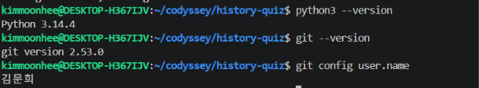
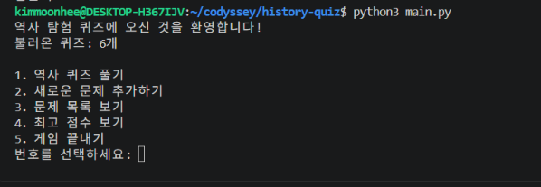
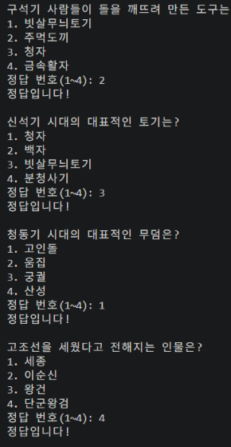
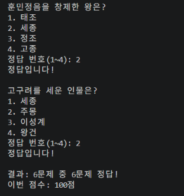
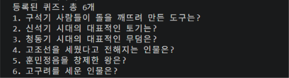
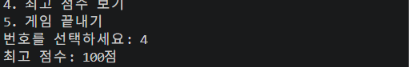
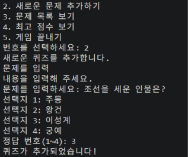
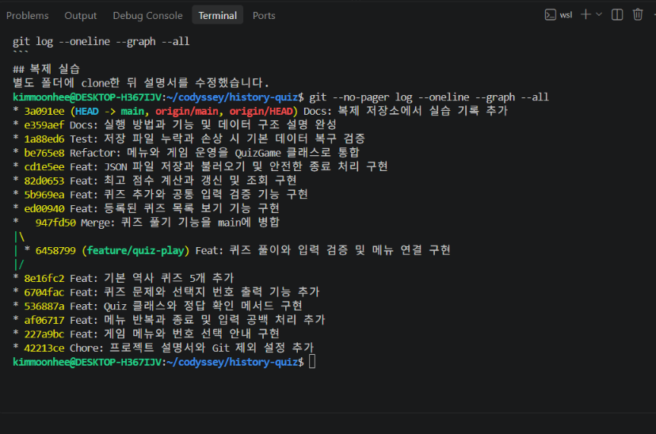

# 역사 탐험 퀴즈

## 1. 프로젝트 개요

Python으로 만든 한국사 콘솔 퀴즈 게임입니다.
터미널에서 퀴즈 풀기, 문제 추가, 목록 보기, 최고 점수 확인을 할 수 있습니다.
문제와 최고 점수는 state.json에 저장되어 재실행해도 유지됩니다.

저장소 URL:
https://github.com/moon7-joon/history-quiz

## 2. 주제 선정 이유

역사 수업에서 배운 내용을 퀴즈로 재미있게 복습하기 위해
한국사 기초를 주제로 선택했습니다.

quiz_data.py의 기본 문제는 다음 5개입니다.

1. 구석기 시대의 도구
2. 신석기 시대의 토기
3. 청동기 시대의 무덤
4. 고조선의 건국
5. 훈민정음 창제

게임에서 고구려와 조선 건국 문제도 추가했습니다.
문제마다 선택지는 4개이며 정답은 1~4의 정수로 관리합니다.

## 3. 실행 환경과 방법

- Python 3.10 이상
- 개발 시 확인한 환경: WSL Ubuntu, Python 3.14.4, Git 2.53.0
- 외부 패키지 설치 불필요
- 표준 라이브러리: json, pathlib, tempfile

프로젝트 폴더에서 실행합니다.

```bash
python3 main.py
```

메뉴 번호를 입력한 뒤 Enter를 누릅니다.

## 4. 기능

| 메뉴 | 기능 |
|---|---|
| 1 | 저장된 퀴즈를 풀고 정답·오답과 최종 점수 확인 |
| 2 | 문제, 선택지 4개, 정답 번호를 입력해 등록 |
| 3 | 등록된 문제 목록 확인 |
| 4 | 최고 점수 확인 |
| 5 | 데이터 저장 후 종료 |

점수는 정답 수 ÷ 전체 문제 수 × 100을 반올림합니다.
예를 들어 6문제 중 4개를 맞히면 67점입니다.
아직 게임을 완료하지 않았다면 최고 점수가 없다고 안내합니다.

문제 추가 직후, 퀴즈 풀이 완료 후, 프로그램 종료 시 저장합니다.

## 5. 실제 실행 화면

아래 이미지는 직접 실행하며 캡처한 화면입니다.
풀이 캡처는 문제를 추가하기 전의 6문제 실행 기록입니다.
이후 조선 건국 문제를 추가하여 저장된 문제 수는 늘어났습니다.

### 개발 환경



### 메뉴



### 문제 풀이



### 풀이 결과



### 문제 목록



### 최고 점수 조회



### 새 문제 등록



[전체 스크린샷 폴더](docs/screenshots/)

## 6. 파일 구조

| 파일 | 역할 |
|---|---|
| main.py | main()에서 게임 객체 생성 및 run() 호출 |
| quiz.py | Quiz 클래스: 개별 문제 정보와 동작 관리 |
| quiz_data.py | create_default_quizzes()로 기본 문제 5개 생성 |
| quiz_game.py | QuizGame 클래스: 메뉴, 입력, 풀이, 등록, 점수 관리 |
| storage.py | save_state(), load_state()로 JSON 저장과 불러오기 |
| state.json | 등록된 문제와 최고 점수 |
| check_quiz.py | 문제 생성, 정답 판정, 출력 확인 |
| check_storage.py | 임시 파일로 누락·손상 복구 검사 |
| docs/screenshots/ | 실행 화면과 개발 환경·Git 기록 이미지 |
| docs/evidence/ | 실제 Git 로그와 원격 저장소 정보 |
| .gitignore | 자동 생성 파일과 가상환경 제외 |
| README.md | 실행 방법, 설계 설명, 검증 자료 |

## 7. 클래스를 사용한 이유

Quiz는 문제 한 개의 question, choices, answer를 함께 보관합니다.
display(), check_answer(), to_dict()는 그 문제의 정보를 사용합니다.

QuizGame은 여러 문제와 최고 점수를 보관하며 게임을 진행합니다.
문제 카드와 게임 진행자의 책임을 나누어 수정할 위치를 명확히 했습니다.

함수만으로도 구현할 수 있지만, 매번 문제 정보와 게임 상태를 전달하는 대신
객체가 자신의 상태와 관련 기능을 함께 갖도록 클래스를 선택했습니다.

예를 들어 Quiz 인스턴스는 자신의 정답을 비교하고,
QuizGame 인스턴스는 전체 정답 수와 최고 점수를 관리합니다.

__init__은 객체가 만들어질 때 초기 정보를 설정합니다.
self는 메서드가 사용하고 있는 객체 자신을 가리킵니다.

## 8. 입력 처리와 기능 분리

QuizGame.read_text()는 빈 문제와 빈 선택지를 다시 입력받습니다.
QuizGame.read_number()는 정수 변환과 허용 범위를 확인합니다.
두 메서드는 입력 앞뒤 공백을 제거합니다.

입력 예시:

```text
번호를 선택하세요: abc
1~5 사이의 숫자를 입력해 주세요.
번호를 선택하세요: 9
1~5 사이의 숫자를 입력해 주세요.
번호를 선택하세요:
1~5 사이의 숫자를 입력해 주세요.
번호를 선택하세요:  3
등록된 퀴즈 목록 출력
```

처리 흐름:
입력 → 공백 제거 → 숫자 변환 → 범위 검사 → 기능 실행 → 필요 시 저장

read_number()는 올바른 숫자를 얻는 일만 담당합니다.
storage.py는 파일을 읽고 쓰며 저장 데이터의 구조를 검사합니다.
예를 들어 정답 번호 0의 재입력은 QuizGame이,
state.json의 answer가 잘못된 경우 기본값 복구는 storage가 담당합니다.

문제가 없으면 play()와 show_list()는 안내 후 반환합니다.
Ctrl+C와 입력 종료는 run()에서 처리하고 finally에서 저장을 시도합니다.

## 9. JSON을 선택한 이유와 데이터 구조

JSON은 사람이 읽을 수 있는 텍스트 형식이며,
문제 목록과 선택지처럼 중첩된 정보를 구조적으로 표현하기 쉽습니다.
Python 표준 라이브러리만으로 저장하고 불러올 수 있어 선택했습니다.

프로젝트 루트의 state.json을 UTF-8로 읽고 씁니다.
경로는 storage.py에서 다음과 같이 정합니다.

```python
STATE_PATH = Path(__file__).resolve().parent / "state.json"
```

터미널의 현재 위치가 달라도 같은 프로젝트 파일을 사용합니다.

데이터 예시이며, 문제는 한 개만 표시했습니다.

```json
{
    "quizzes": [
        {
            "question": "고구려를 세운 인물은?",
            "choices": ["세종", "주몽", "이성계", "왕건"],
            "answer": 2
        }
    ],
    "best_score": 100
}
```

| 필드 | 형식과 설계 이유 |
|---|---|
| quizzes | 여러 문제를 순서대로 보관하기 위한 리스트 |
| question | 문제 문장을 담는 문자열 |
| choices | 선택지 순서와 정답 번호의 대응을 유지하는 4개 문자열 리스트 |
| answer | 비교를 단순하게 하고 화면 번호와 일치시키는 1~4 정수 |
| best_score | 문제 전체와 별도로 관리하는 최고 점수. 없으면 null |

각 문제는 이름이 붙은 필드를 가진 딕셔너리로 저장합니다.
quizzes 안에 문제 딕셔너리를 넣어 문제 수가 늘어나도 같은 구조를 사용합니다.
Python의 None은 JSON에서 null로 저장됩니다.

## 10. 오류 처리와 복구 정책

불러오기 흐름:
파일 읽기 → JSON 해석 → 필드와 자료형 검증 → Quiz 객체 생성

파일이 없거나 JSON·필드·자료형에 문제가 있으면 안내하고
기본 문제 5개와 최고 점수 없음 상태로 시작합니다.
이 상태에서 저장하면 기본 데이터로 파일이 생성되거나 교체됩니다.

파일 읽기·쓰기 오류는 try/except로 처리합니다.
쓰기 실패 시 안내하고 False를 반환합니다.
현재 자동 재시도와 자동 백업은 구현하지 않았습니다.

저장 실패 시 확인할 항목:
- 프로젝트 폴더가 쓰기 가능한 위치인지
- 폴더와 파일의 쓰기 권한이 있는지
- 저장 장치의 여유 공간이 있는지

실패 원인을 해결하고 다시 저장해야 합니다.
저장하지 못한 변경은 프로그램을 종료하면 사라질 수 있습니다.

수동 백업 방법:
게임을 종료한 상태에서 실행합니다.

```bash
cp state.json state.json.bak
```

수동 복구 방법:
게임을 종료하고 현재 파일을 별도로 보관한 뒤 백업을 복원합니다.

```bash
cp state.json state.json.before-restore
cp state.json.bak state.json
```

백업은 직접 실행해야 하며, 백업 파일 자체가 올바른지도 확인해야 합니다.
현재 저장은 파일 전체를 직접 덮어쓰므로 저장 중 강제 종료나 전원 차단 시
파일이 손상될 수 있습니다. 임시 파일을 쓴 뒤 교체하는 저장 방식은 향후 개선점입니다.

## 11. JSON 방식의 한계와 개선 방향

현재는 전체 JSON 파일을 읽어 메모리에 올리고,
저장할 때도 전체 데이터를 다시 씁니다.
따라서 데이터가 커지면 읽기·쓰기 시간과 메모리 사용량이 증가할 수 있습니다.

여러 프로그램이 동시에 저장하면 서로의 변경을 덮어쓸 수도 있습니다.
현재 프로그램은 개인이 한 번에 하나 실행하는 사용을 전제로 합니다.

문제와 사용자 기록이 많아지거나 동시 사용이 필요하면
SQLite 등 데이터베이스를 검토할 수 있습니다.
데이터베이스를 도입할 때는 저장 계층을 수정하고
게임 기능과의 연결도 다시 검증해야 합니다.

## 12. Git 작업과 실제 증빙

저장소:
https://github.com/moon7-joon/history-quiz

- [실제 커밋·병합 로그](docs/evidence/git-log.txt)
- [원격 저장소 주소 기록](docs/evidence/remote.txt)
- [Git 로그 스크린샷](docs/screenshots/git-log.png)



증빙 로그 생성 시점에 19개 커밋이 기록되어 있습니다.
증빙 추가 후 커밋 수는 더 늘어날 수 있습니다.

직접 사용한 Git 명령:
init, add, commit, push, pull, checkout, clone, merge

### 커밋 단위와 메시지 규칙

메뉴, 문제 클래스, 기본 문제, 풀이, 등록, 점수, 파일 저장,
설명서 등 의미 있는 작업 단위로 나누어 기록합니다.

메시지 형식:
종류: 변경 내용 요약

| 종류 | 사용 목적 |
|---|---|
| Feat | 새 기능 |
| Fix | 오류 수정 |
| Docs | 문서와 증빙 |
| Refactor | 동작을 유지하면서 구조 정리 |
| Test | 검증 코드 |
| Chore | 프로젝트 설정 |
| Data | 문제 등 데이터 변경 |

실제 기록 예시:
- Feat: 기본 역사 퀴즈 5개 추가
- Feat: 퀴즈 풀이와 입력 검증 및 메뉴 연결 구현
- Refactor: 메뉴와 게임 운영을 QuizGame 클래스로 통합
- Test: 저장 파일 누락과 손상 시 기본 데이터 복구 검증

### 브랜치를 나눈 이유와 병합

퀴즈 풀이 기능은 main에서 분리한 feature/quiz-play에서 개발했습니다.
기본 작업을 유지하며 별도 갈래에서 기능을 구현하고 검증하기 위해서입니다.
브랜치는 폴더 복사본이 아니라 Git의 작업 이력을 나누는 방식입니다.

실제 풀이 기능 커밋:
6458799

main으로 합친 병합 커밋:
947fd50

사용한 명령:

```bash
git checkout -b feature/quiz-play
git checkout main
git merge --no-ff feature/quiz-play -m "Merge: 퀴즈 풀기 기능을 main에 병합"
```

병합은 다른 갈래의 변경을 현재 갈래에 통합하는 작업입니다.
병합 전 변경 사항을 기록하고, 충돌이 나면 내용을 확인해 해결한 뒤
통합된 프로그램이 정상 실행되는지 확인해야 합니다.

### clone과 pull 수행 기록

원본 작업 폴더:
~/codyssey/history-quiz

별도 복제 폴더:
~/codyssey/history-quiz-copy

다음 순서로 실습했습니다.

1. GitHub 저장소를 별도 폴더에 clone했습니다.
2. 복제본 README에 복제 실습 문장을 추가했습니다.
3. 복제본에서 commit 후 push했습니다.
4. 원본 폴더에서 pull했습니다.
5. tail 명령으로 원본 README에도 문장이 생긴 것을 확인했습니다.

사용한 명령:

```bash
cd ~/codyssey
git clone https://github.com/moon7-joon/history-quiz.git history-quiz-copy
cd history-quiz-copy
git add README.md
git commit -m "Docs: 복제 저장소에서 실습 기록 추가"
git push
cd ~/codyssey/history-quiz
git pull
tail -n 5 README.md
```

복제본의 수정 커밋:
3a091ee Docs: 복제 저장소에서 실습 기록 추가

pull 당시 확인한 출력:

```text
Updating e359aef..3a091ee
Fast-forward
README.md | 4 +++-
1 file changed, 3 insertions(+), 1 deletion(-)
```

변경 반영 확인 문장:

```text
## 복제 실습
별도 폴더에 clone한 뒤 설명서를 수정했습니다.
```

위 출력은 실습 당시 확인한 결과를 문서에 옮긴 기록입니다.
커밋은 Git 로그에서 확인할 수 있으며,
원본 폴더에서 pull한 사실은 위 실습 기록과 함께 확인합니다.

## 13. 검증 방법과 확인 결과

```bash
python3 check_quiz.py
python3 check_storage.py
python3 main.py
```

| 확인 항목 | 관찰한 결과 |
|---|---|
| 정답과 오답 | 정답 판정 및 오답 시 정답 번호 안내 |
| 글자·범위 밖·빈 입력 | 안내 후 재입력 |
| 입력 앞뒤 공백 | 공백 제거 후 처리 |
| 퀴즈 추가 | 등록 후 목록에 반영 |
| 재실행 | 추가 문제와 최고 점수 유지 |
| Ctrl+C | 종료 안내 후 저장 |
| 입력 종료 Ctrl+D | 종료 안내 후 저장 |
| 파일 없음 | 기본 문제 5개로 시작 |
| 파일 손상 | 안내 후 기본 문제 5개로 시작 |

check_storage.py는 임시 폴더를 사용하므로 실제 state.json을 바꾸지 않습니다.

확인한 검사 출력:

```text
[1] 저장 파일이 없는 경우
저장 파일이 없어 기본 문제로 시작합니다.
통과: 기본 문제 5개로 시작합니다.

[2] 저장 파일이 손상된 경우
저장 파일 내용에 문제가 있어 기본 문제로 시작합니다.
통과: 기본 문제 5개로 복구합니다.
```

검증 범위의 한계:
실제 디스크 공간 부족이나 쓰기 권한 거부 상황은 별도로 재현하지 않았습니다.
코드에서 OSError를 처리하지만 모든 파일 시스템 오류를 시험한 것은 아닙니다.

## 14. 요구사항 변경 시 수정 위치

| 변경할 내용 | 주요 파일·함수·메서드 |
|---|---|
| 기본 문제와 주제 | quiz_data.py의 create_default_quizzes() |
| 문제 출력 형식 | quiz.py의 Quiz.display() |
| 정답 판정 | quiz.py의 Quiz.check_answer() |
| 저장용 문제 필드 | Quiz.to_dict(), storage.load_state() |
| 메뉴 추가 | QuizGame.show_menu(), run(), 메뉴 입력 범위 |
| 점수 계산과 최고 점수 정책 | QuizGame.play(), show_score(), 필요 시 저장 데이터 검증 |
| 새 문제 등록 과정 | QuizGame.add_quiz() |
| 입력 검증 | QuizGame.read_text(), read_number() |
| 저장 위치와 파일 처리 | storage.py의 STATE_PATH, save_state(), load_state() |
| 종료 처리 | QuizGame.run() |
| 게임 시작 | main.py의 main() |

선택지 수를 4개에서 바꾸려면 출력만 고치는 것으로 끝나지 않습니다.
기본 데이터, add_quiz()의 반복 범위, 정답 입력 범위,
load_state()의 선택지 개수·정답 범위 검사도 함께 수정해야 합니다.

기본 문제를 바꾸더라도 기존 state.json이 있으면 저장된 문제가 먼저 사용됩니다.
기본 데이터 변경과 기존 저장 데이터 변경은 구분해야 합니다.